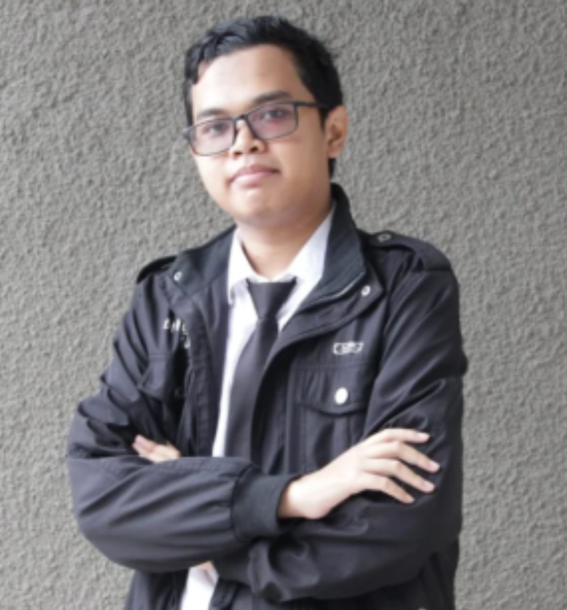

# ROOMASTER

**Mata Kuliah:** Perencanaan & Pengembangan Perangkat Lunak — Kelas A

## Deskripsi Produk

Roomaster merupakan platform digital terintegrasi yang dirancang untuk mempermudah proses peminjaman ruangan serta pelaporan kerusakan fasilitas di lingkungan Institut Teknologi Sepuluh Nopember (ITS). Aplikasi ini dikembangkan sebagai solusi atas permasalahan proses peminjaman ruangan yang masih memiliki tahapan birokrasi cukup panjang, kurangnya transparansi informasi ketersediaan ruangan, serta belum adanya media pelaporan kerusakan fasilitas yang terintegrasi.

### Latar Belakang

Proses peminjaman ruangan di lingkungan ITS sebelumnya masih melibatkan beberapa tahapan administrasi dan koordinasi dengan berbagai pihak, seperti Biro Manajemen Aset (BMA) dan Tata Usaha (TU). Pengguna sering kali harus melakukan konfirmasi dan follow-up berulang kali untuk mengetahui ketersediaan ruangan maupun status pengajuan peminjaman. Selain itu, informasi mengenai jadwal penggunaan ruangan belum tersedia secara terpusat dan transparan.

Di sisi lain, mahasiswa maupun civitas akademika yang menemukan kerusakan fasilitas kampus belum memiliki media pelaporan yang jelas dan terintegrasi dengan pihak Sarana dan Prasarana (Sarpras). Kondisi tersebut dapat menyebabkan keterlambatan penanganan kerusakan serta kurangnya transparansi terhadap proses perbaikan fasilitas.

### Tujuan

Oleh sebab itu, kami hendak mengembangkan Roomaster sebagai platform digital terintegrasi yang dapat menyederhanakan proses peminjaman ruangan dan menyediakan sistem pelaporan kerusakan fasilitas kampus, sehingga mahasiswa dan civitas akademika dapat mengakses informasi ketersediaan ruangan, mengajukan peminjaman, serta melaporkan kerusakan fasilitas secara lebih mudah, efisien, dan transparan.

### Manfaat

Dengan demikian, diharapkan bahwa Roomaster dapat meningkatkan efisiensi administrasi peminjaman ruangan, mengurangi kebutuhan koordinasi dan follow-up manual, serta meningkatkan transparansi informasi antara pengguna dan pihak pengelola fasilitas kampus. Selain itu, aplikasi ini diharapkan dapat membantu pihak Sarpras dalam memantau dan menangani kerusakan fasilitas secara lebih terstruktur, sehingga tercipta ekosistem pengelolaan fasilitas kampus ITS yang responsif, terorganisir, dan berbasis data.

## Anggota Kelompok

<table>
  <tr>
    <td align="center"> <b>Muhammad Trinanda Thoriq</b> 5026241124</td>
    <td align="center"> <b>Satya Azka Aqilla</b> 5026241199</td>
    <td align="center"> <b>Anastasia Azzahra Rafif</b> 5026241036</td>
    <td align="center"> <b>Muhammad Satrio Adjie</b> 5026241065</td>
    <td align="center"> <b>Thalia Harnum Fathina</b> 5026241201</td>
  </tr>
</table>

| NRP | Nama |
| --- | --- |
| 5026241124 | Muhammad Trinanda Thoriq |
| 5026241199 | Satya Azka Aqilla |
| 5026241036 | Anastasia Azzahra Rafif |
| 5026241065 | Muhammad Satrio Adjie |
| 5026241201 | Thalia Harnum Fathina |
